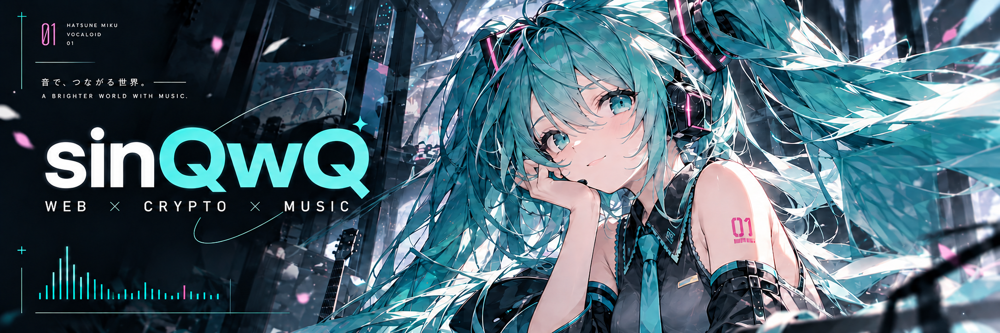

  

<h2 align="center">Hello, world. Hello, Miku.</h2>

<b>UCAS · 网络空间安全 · NeSE</b>

  
  
  

  <a href="https://sinqwq.top/"><b>✦ sinQwQの空 · BLOG ↗</b></a>
  &nbsp; / &nbsp; <a href="https://sinqwq.top/about/">关于我</a>
  &nbsp; / &nbsp; <a href="https://sinqwq.top/archive/">文章归档</a>

<table>
<tr>
<td width="50%" valign="top">

<h3>⌁ Web / Crypto CTF</h3>
解题、复盘，记录每次探索的思路。
<h3>⌘ Cybersecurity</h3>
学习渗透测试与开发，把想法放进实验里。
<h3>▤ Writeups &amp; Notes</h3>
在博客整理题解、技术笔记和踩过的坑。
</td>
<td width="50%" valign="top">

<h3>♫ Hatsune Miku</h3>
初音未来，以及音乐带来的灵感。
<h3>♪ Vocal Synth</h3>
喜欢虚拟歌声，也做一点音乐创作。
<h3>✦ Beyond the code</h3>
Keep learning. Keep loving. 
Remain a disciple of life.
</td>
</tr>
</table>

<table>
<tr><td width="18%" align="center"><b>01</b> Web / Crypto</td><td>
<h3><a href="https://sinqwq.top/posts/heroctf2025/">HeroCTF2025 ↗</a></h3>
记录 JWT 吊销绕过、Tomcat 会话共享、SAML 断言注入与位运算、RC4 题目的解题思路。
</td></tr>
<tr><td align="center"><b>02</b> Web / Crypto / Misc</td><td>
<h3><a href="https://sinqwq.top/posts/hkcertctf2025/">HKCERTCTF2025 ↗</a></h3>
整理双重 SSRF 访问 MCP、反序列化与模板注入，并记录协议逆向、RSA 及 GCM 题解。
</td></tr>
<tr><td align="center"><b>03</b> Web / AI</td><td>
<h3><a href="https://sinqwq.top/posts/%E7%AC%AC%E4%B8%89%E5%B1%8A%E6%95%B0%E4%BF%A1%E6%9D%AF/">第三届数信杯 ↗</a></h3>
复盘模型数据投毒、pickle 反序列化和图像对抗样本，重点分析标签反转与预处理一致性。
</td></tr>
</table>

<a href="https://sinqwq.top/"><b>更多记录，写在 sinQwQの空 ↗</b></a>

  

基于 GitHub 账号公开数据生成 · 点击查看原始贡献记录

Keep learning. Keep loving. Remain a disciple of life.

♫ &nbsp; ━━━━━ &nbsp; 39 &nbsp; ━━━━━ &nbsp; ♫

